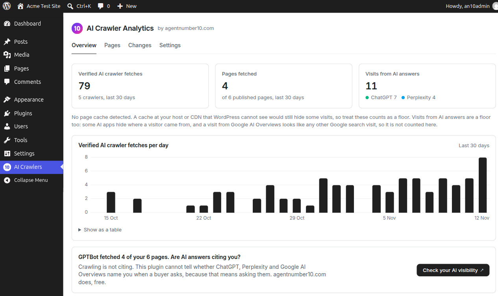
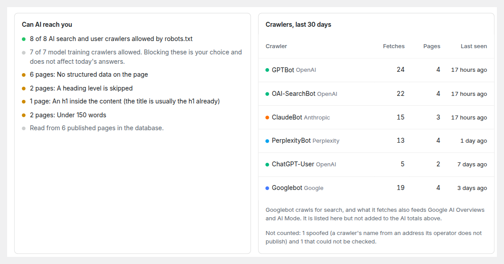

# AN10 – AI Crawler Analytics

[](https://github.com/agentnumber10/an10-ai-crawler-analytics/actions/workflows/ci.yml)

Privacy-first AI crawler analytics for WordPress. Anyone can send
`User-agent: GPTBot`, so this plugin checks every claimed AI crawler visit
against the IP addresses its operator publishes, counts only the real ones
and flags the fakes. It also shows which pages no AI crawler has fetched,
and the visits that arrive from AI answers in ChatGPT, Perplexity and
others.

No account, no IP addresses stored, and nothing about your site sent
anywhere. Made by [agentnumber10.com](https://agentnumber10.com).



The full description, privacy notes and the external services the plugin
can use are in the WordPress.org readme, [readme.txt](readme.txt).

## Requirements

WordPress 6.5 or later and PHP 8.0 or later. No account and no other plugin.

## Install

From a release: download `an10-ai-crawler-analytics-<version>.zip` from the
[releases page](https://github.com/agentnumber10/an10-ai-crawler-analytics/releases),
then in WordPress go to Plugins, Add New, Upload Plugin, choose the zip and
activate it. The plugin's screen is AI Crawlers in the admin menu.

From source: follow Development below, run `bash bin/build.sh` and upload the
zip it writes to `build/`.

Crawler verification starts off. Turn it on from the card on the plugin's
Overview screen when you want visits checked against the operators' published
address lists.

## How it works

- **Crawler requests.** On each front-end request whose user agent names a
  known AI crawler, the plugin records the time, the crawler, the page, the
  HTTP status and whether the address matched the operator's published list.
  The address itself is never stored.
- **Visits from AI answers.** A small script on public pages sends one request
  to the site's own REST route, `POST /wp-json/an10/v1/visit`, with the
  referring host (`ref`), any `utm_source` (`utm`), the post id (`id`) and the
  path (`path`). The route is public because cached pages cannot carry a
  nonce. It keeps a visit only when the referrer or `utm_source` maps to a
  known AI engine, is capped per minute and per day, and stores the time,
  engine and page.
- **Crawler verification** is off until the site owner turns it on. Then the
  operators' published IP lists are downloaded once a day. readme.txt lists
  every URL under External services.
- **Data** lives in one table, `{prefix}an10_events`, and a few `an10_*`
  options. Uninstalling deletes it only if the owner chose that in Settings.



## Development

Requirements: PHP 8.0 or later and Composer. See
[CONTRIBUTING.md](CONTRIBUTING.md) for the checks, commit format and the rules
the plugin keeps.

```sh
composer install
vendor/bin/phpunit
bash bin/build.sh   # writes build/an10-ai-crawler-analytics-<version>.zip
```

## Licence

GPLv2 or later. See [LICENSE](LICENSE). The bundled Inter and JetBrains Mono
typefaces are under the SIL Open Font License 1.1 (assets/fonts/OFL.txt).
